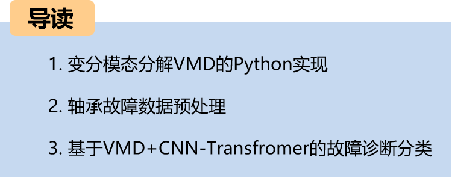
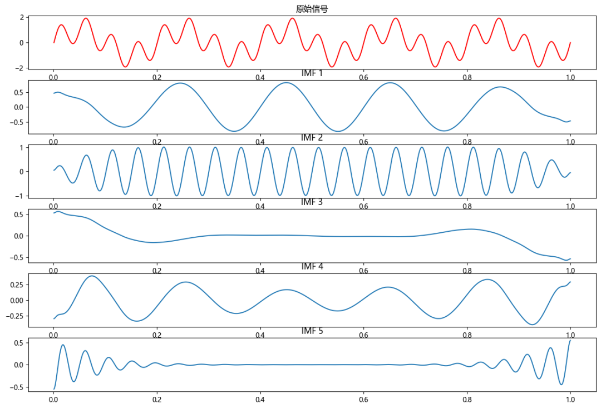
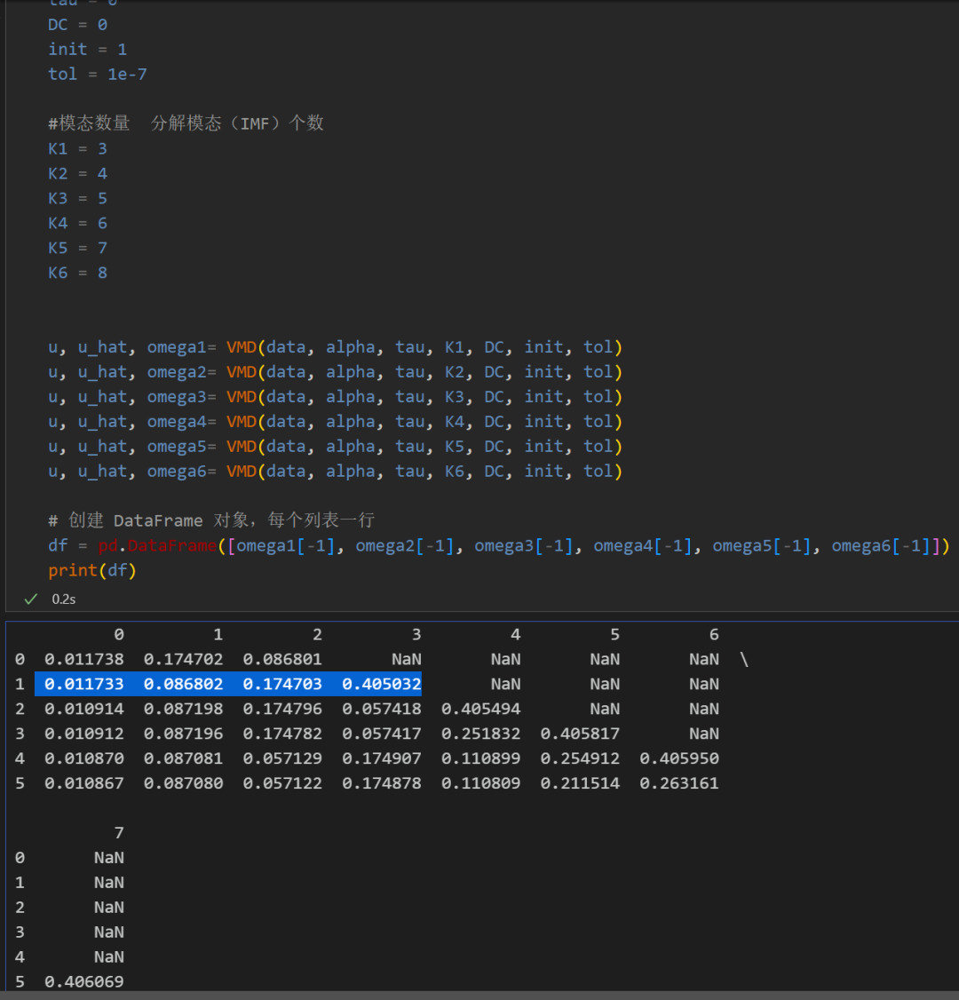
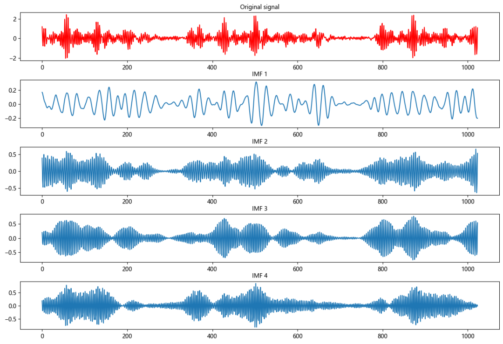
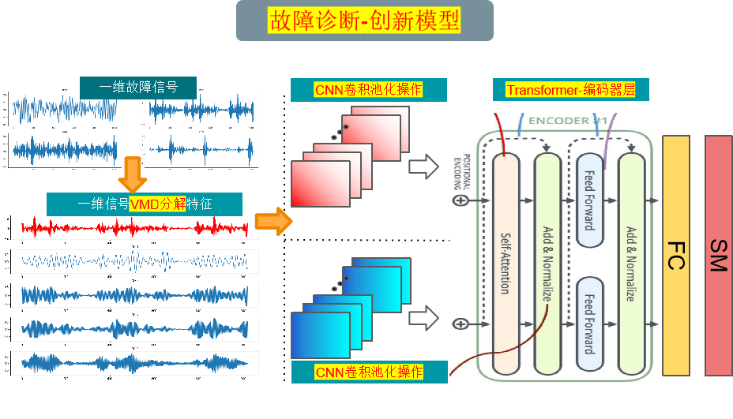
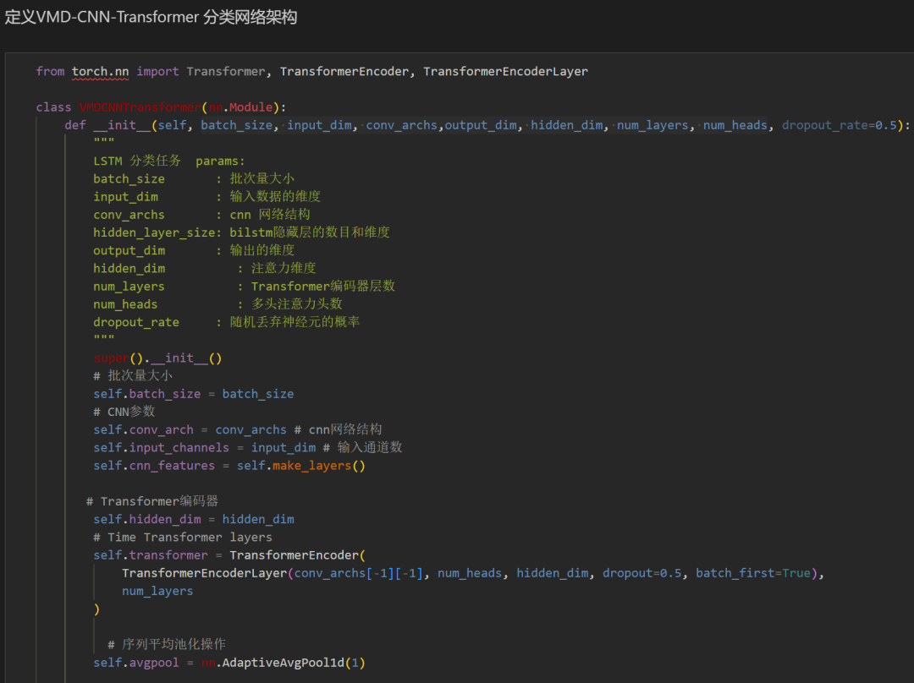
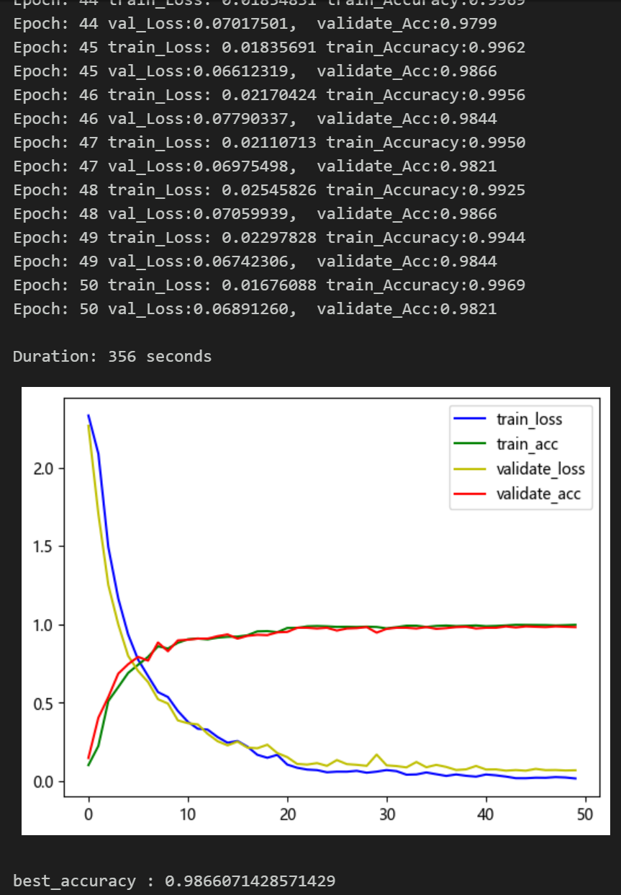
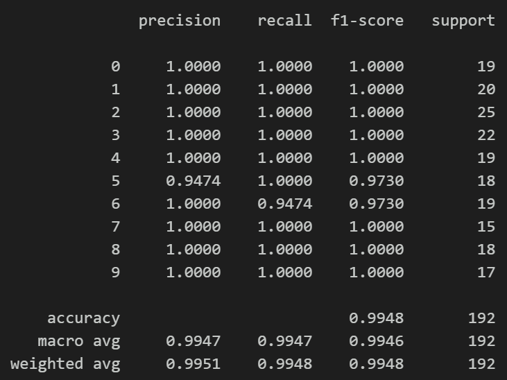
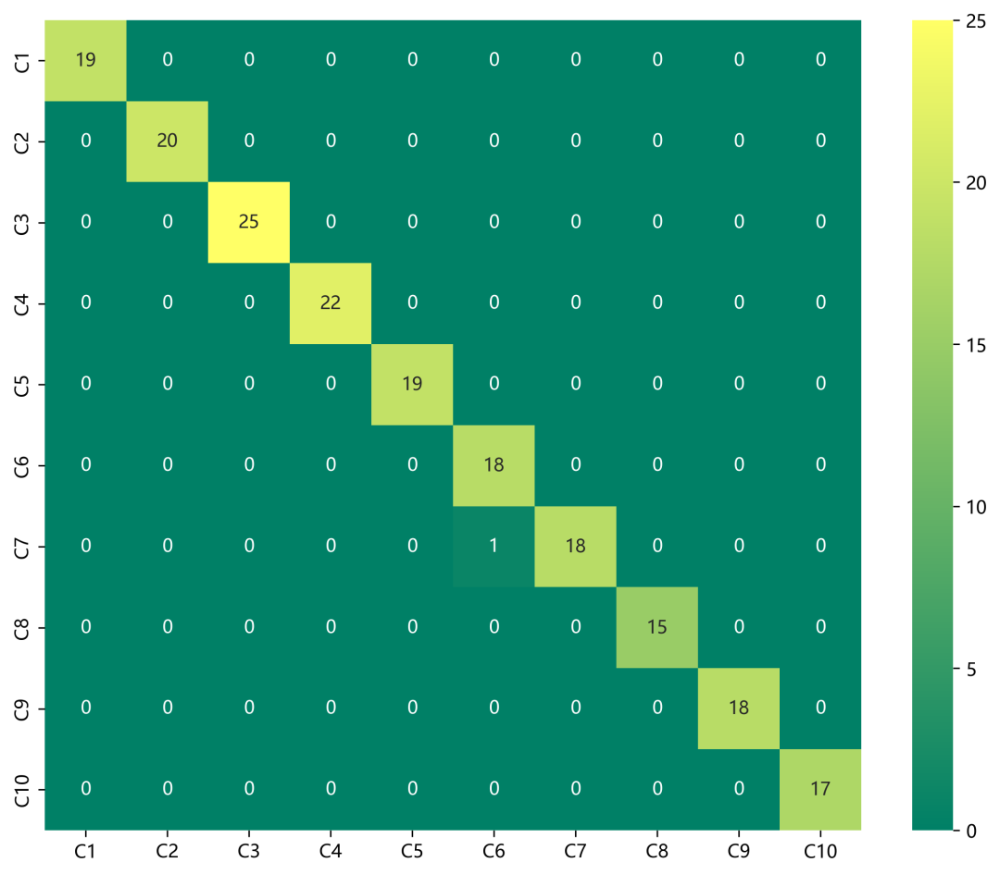
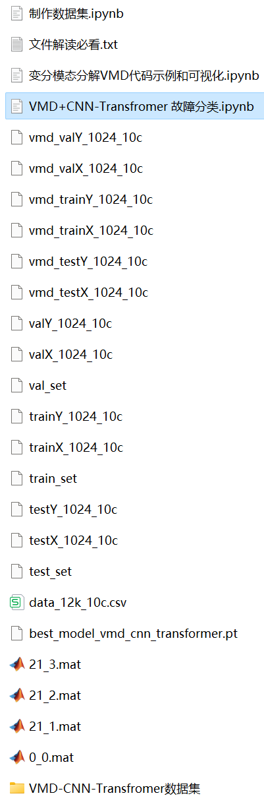

# Bearing Faults VM-DCNN-Transformer Classification Model

The family bucket includes the following content:
1. Thesis innovation!!!
Including a complete CWRU bearing fault dataset, as well as fault signal datasets, classification data sets, and label sets that have been generated and prepared. All corresponding codes can be run. There is also an example of Variational Mode Decomposition (VMD) for demonstration.
50 epochs, with an accuracy rate of 98%. The classification effect of the VMD+CNN-Transformer network is significant. The model can fully extract spatial, temporal, and frequency domain features of bearing fault signals, with fast convergence speed and superior performance, high accuracy. Innovation is also present!!!
Includes code for data preprocessing and the classification code using VMD+CNN-Transformer.
Environment: Python 3.9
Preface
This article is based on bearing data from Case Western Reserve University (CWRU), introducing and preprocessing the Variational Mode Decomposition (VMD) and finally classifying fault data through Python using VMD+CNN-Transformer.
1. A Python example of Variational Mode Decomposition (VMD)
First step, download and install the VMD package in Python:
# Download
pip install vmdpy  
# Import
From vmdpy import VMD  
2. Preprocessing of bearing fault data  
2.1 Importing Data  
Refer to previous articles for the preprocessing of fault classification, specifically for the 10-class classification dataset from Case Western Reserve University's bearing data:  
train_set, val_set, test_set are divided into training set, validation set, and testing set in a ratio of 7:2:1, and finally, the data is saved.  
The diagram above shows the format of data reading and the preprocessing idea.  
2.2 Visualization of Fault VMD Decomposition  
First step, modality selection  
Based on different K values, observe the center frequency and select the K value; starting from K=4, there are similar center frequencies, indicating overdecomposition, so the number of modes K is chosen as 4.  
Second step, visualization of fault VMD decomposition  
2.3 Preprocessing of fault data through VMD decomposition  
3. Bearing Fault Diagnosis Classification Based on VMD+CNN-Transformer  
Below is an explanation of the classification method using CNN-Transformer based on the bearing fault data after VMD decomposition:  
3.1 Definition of VMD-CNN-Transformer classification network model  
3.2 Setting parameters and training the model  
50 epochs, with nearly 99% accuracy. The VMD+CNN-Transformer network achieves significant classification results. The CNN-Transformer model can fully extract global spatial and local features of bearing fault signals, with fast convergence speed and exceptional performance. Further tuning of parameters can further improve classification accuracy.  
Note adjustments:  
Adjust the parameters appropriately:  
Increase the number of CNN layers and the dimensionality of the hidden layer, adjust the learning rate slightly.
Adjust the number of Transformer encoder layers and dimensions to increase more epochs (note to prevent overfitting)
Change the shape of the vector signal stacking (set appropriate length and dimension)
3.3 Model evaluation
Accuracy, Precision, Recall, F1 Score
Fault-classification confusion matrix:

## Images

<!-- PAYMENT_BLOCK -->

## Get this dataset

- Payment link (Stripe): [Buy now](https://buy.stripe.com/3cs8yP7sY87d0vu9AB)
- Payment QR code: 

<!-- /PAYMENT_BLOCK -->
